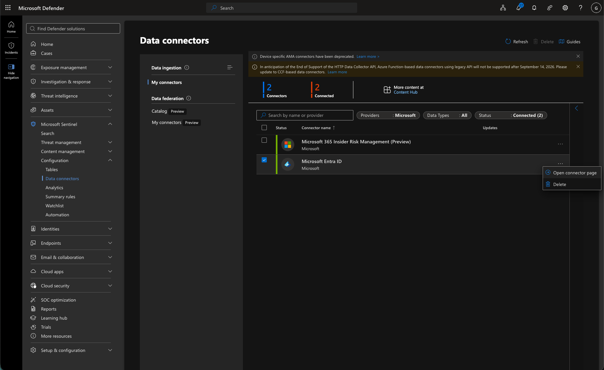
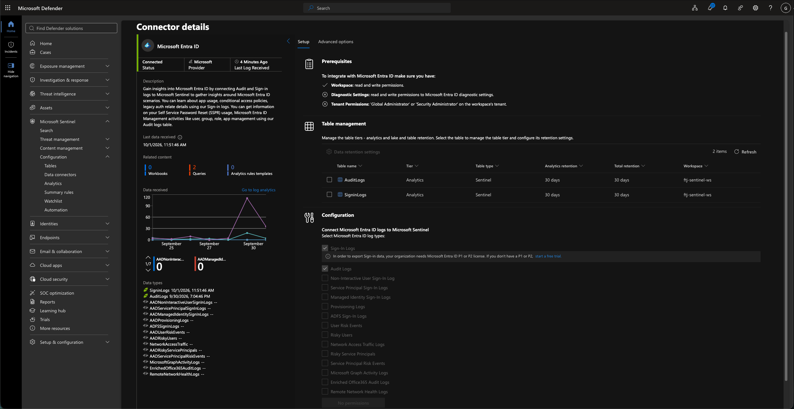
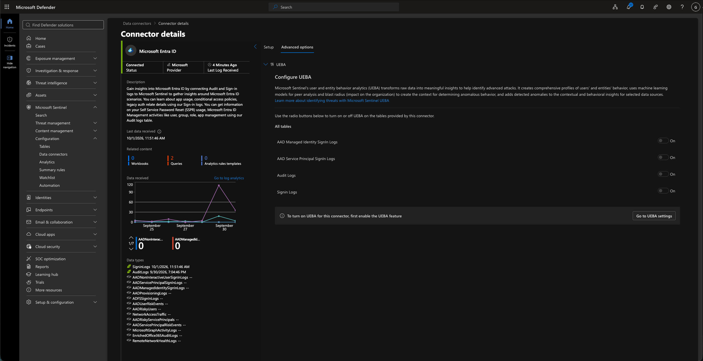
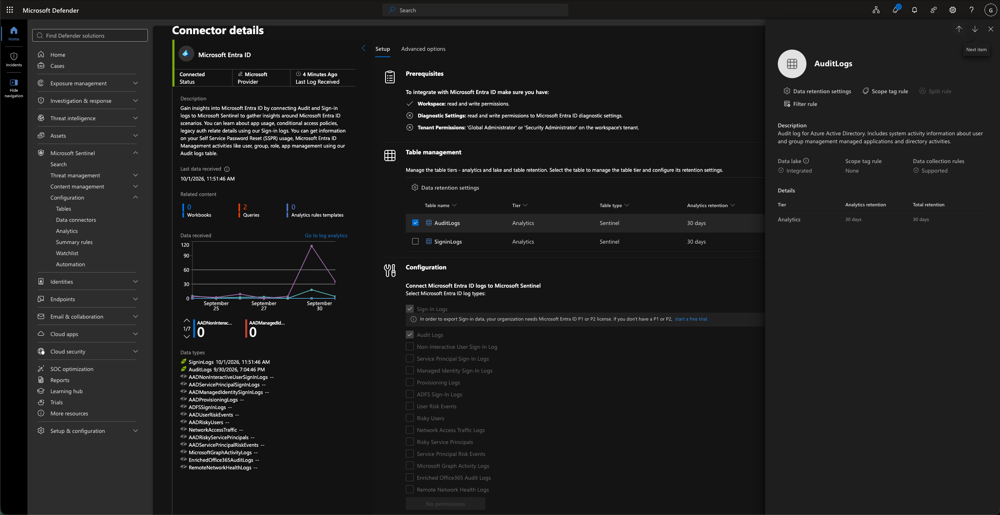
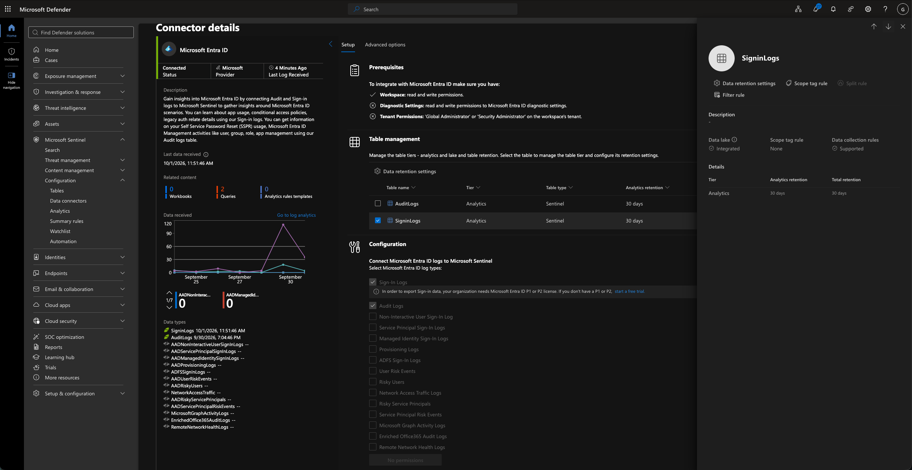
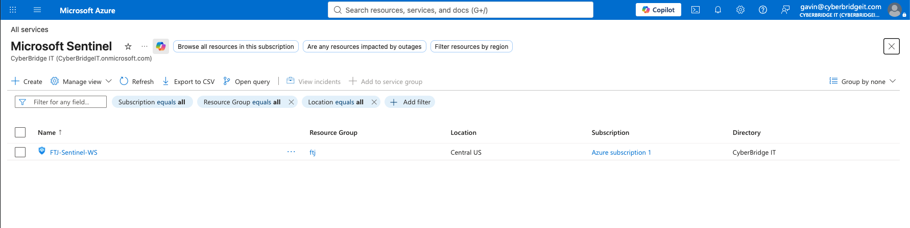
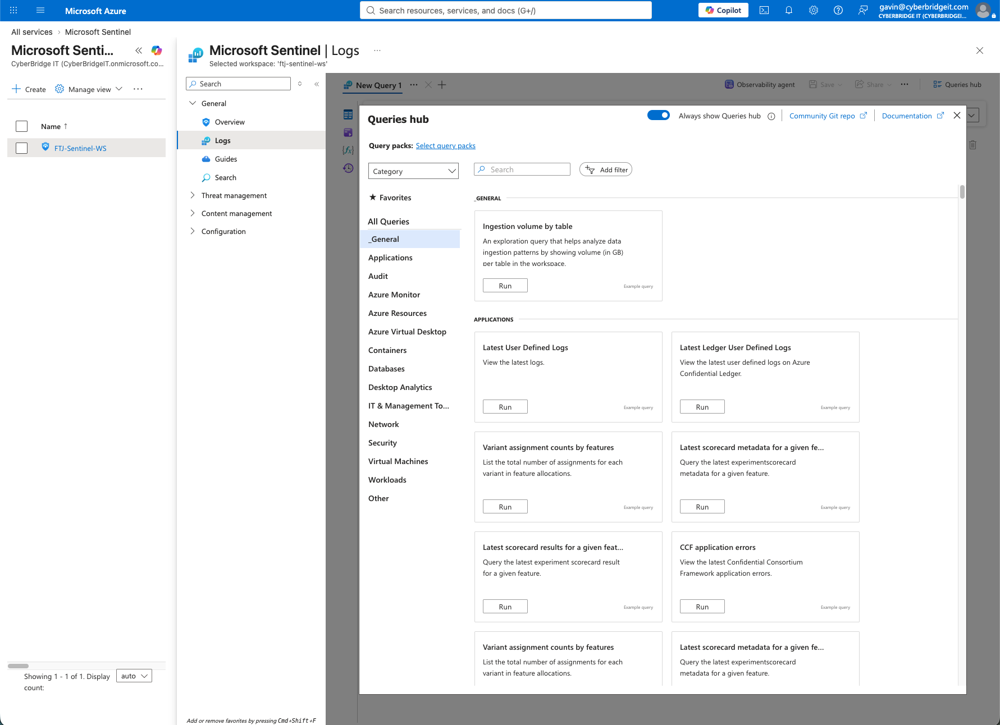
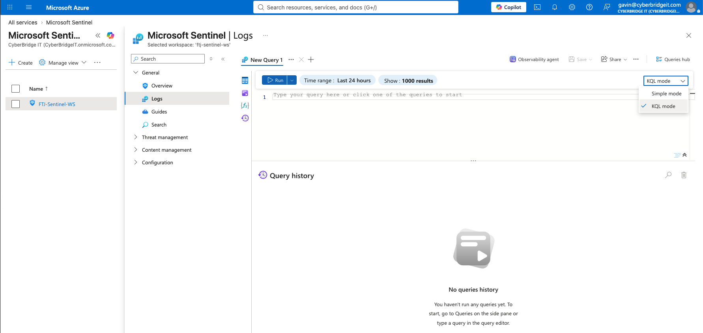
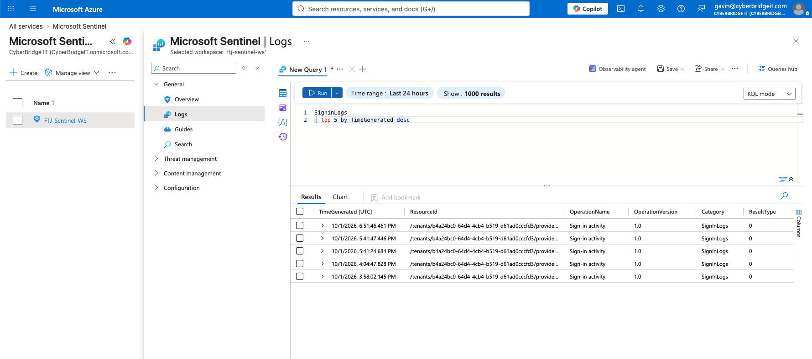

# Sentinel Data Connection and KQL Evidence

This folder contains evidence from reviewing the Microsoft Entra ID data connector and querying identity sign-in data in Microsoft Sentinel.

## Evidence

### 1. Connected Data Connectors



The Data connectors page showed two configured connectors, with both reporting a connected status. Microsoft Entra ID was selected for further review.

### 2. Microsoft Entra ID Connector



The Microsoft Entra ID connector reported a connected status and recent log ingestion. The configuration showed that `AuditLogs` and `SigninLogs` were enabled and stored in the Analytics tier with 30-day retention.

### 3. UEBA Configuration Options



The connector’s advanced options displayed User and Entity Behavior Analytics configuration choices. The page indicated that the UEBA feature had to be enabled before UEBA could be activated for the available identity tables.

### 4. AuditLogs Table Details



The `AuditLogs` table was configured in the Analytics tier with 30 days of analytics and total retention. This table provides visibility into directory and administrative activity.

### 5. SigninLogs Table Details



The `SigninLogs` table was configured in the Analytics tier with 30 days of analytics and total retention. This table provides identity authentication records that analysts can query during investigations.

### 6. Sentinel Workspace Selection



The Microsoft Sentinel workspace was identified and selected before opening the log-analysis interface.

### 7. Logs and Queries Hub



The Sentinel Logs page opened with the Queries hub, which provides predefined queries and access to the query editor.

### 8. KQL Query Mode



The Logs interface was switched to KQL mode so a custom query could be entered directly.

### 9. Sign-In Log Query Results



The following query returned the five most recent sign-in records within the selected time range:

```kusto
SigninLogs
| top 5 by TimeGenerated desc
```

The results confirmed that Microsoft Entra ID sign-in events were available for investigation in Sentinel and could be sorted by event time using KQL.
