# Sentinel Detection Engineering, Automation, and Reporting Evidence

This folder documents the creation of a Microsoft Sentinel scheduled analytics rule, the review of available incident-notification playbook templates, the automation-rule status of the workspace, and the export of a Microsoft Defender incident report.

The evidence was reviewed through the unified Microsoft Defender and Microsoft Sentinel security experience.

## Evidence

### 1. Analytics Rules Before Creation

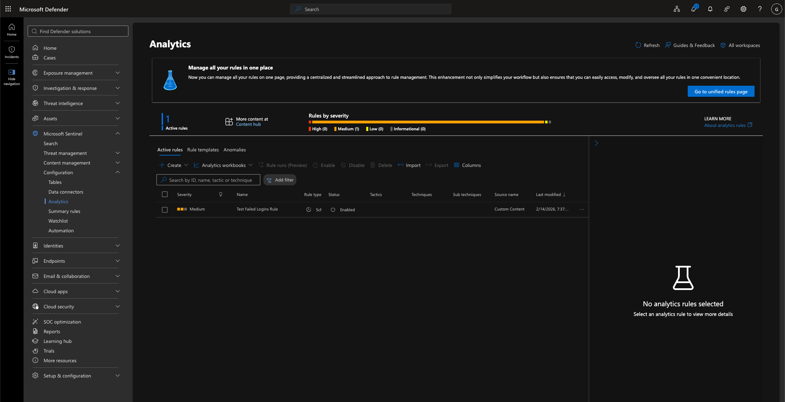

The Microsoft Sentinel Analytics page initially contained one active rule named `Test Failed Logins Rule`.

The existing rule was displayed as:

* Severity: Medium
* Rule type: Scheduled
* Status: Enabled
* Source: Custom Content

This screenshot established the analytics-rule inventory before the new failed-sign-in rule was created.

### 2. Failed Sign-In Rule General Settings

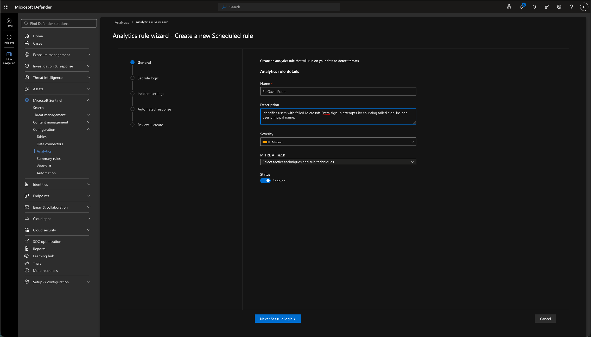

A new scheduled analytics rule was configured with the following general settings:

* Name: `FL-Gavin.Poon`
* Severity: Medium
* Status: Enabled
* MITRE ATT&CK mapping: Not configured

The rule description stated that it identifies users with failed Microsoft Entra sign-in attempts by counting failed sign-ins per user principal name.

These settings defined the rule’s purpose and the severity assigned to alerts generated by the detection.

### 3. Failed Sign-In Rule Query and Schedule

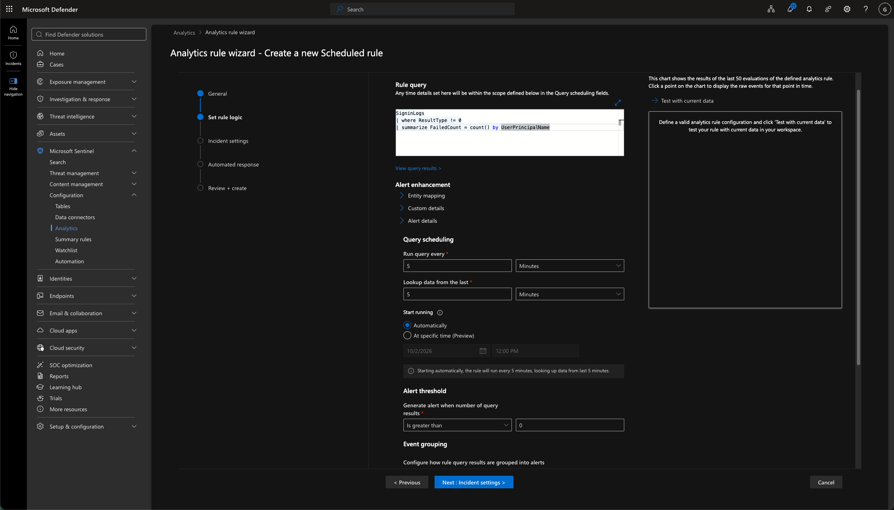

The rule used the following KQL query:

```kusto
SigninLogs
| where ResultType != 0
| summarize FailedCount = count() by UserPrincipalName
```

The query performed two primary operations:

* `ResultType != 0` filtered the sign-in data to unsuccessful authentication attempts.
* `summarize FailedCount = count() by UserPrincipalName` grouped the failures by user and counted the number of failed attempts for each account.

The rule was configured to:

* Run every five minutes.
* Search the previous five minutes of data.
* Start automatically.
* Generate an alert when the query returned more than zero results.

The configured threshold evaluated the number of rows returned by the query. Because the query returns one row for each user with failed sign-in activity, a user with a single failed attempt could cause the rule to meet its trigger condition.

### 4. Failed Sign-In Rule Validation Summary

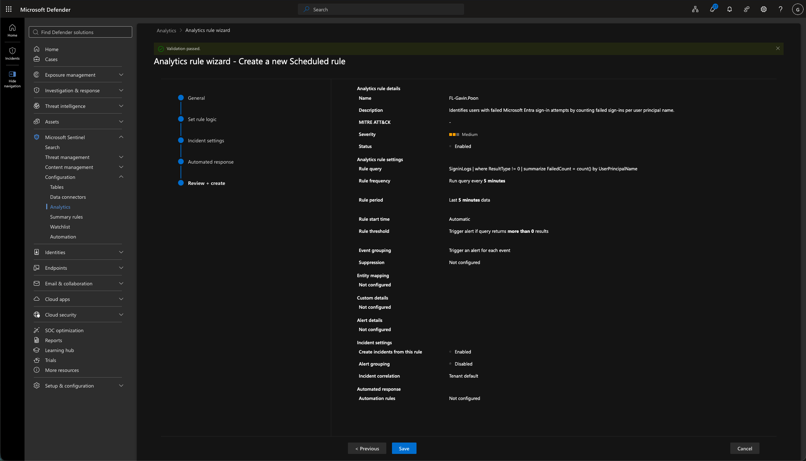

Microsoft Sentinel displayed **Validation passed**, confirming that the rule configuration was accepted.

The review page showed:

* Severity: Medium
* Status: Enabled
* Rule frequency: Every five minutes
* Rule period: Previous five minutes
* Rule threshold: More than zero query results
* Event grouping: Trigger an alert for each event
* Incident creation: Enabled
* Alert grouping: Disabled
* Incident correlation: Tenant default
* Suppression: Not configured
* Entity mapping: Not configured
* Custom details: Not configured
* Alert details: Not configured
* Automation rules: Not configured

Validation confirmed that the configuration could be saved. It did not establish that the rule had generated an alert or incident.

### 5. Enabled Failed Sign-In Analytics Rule

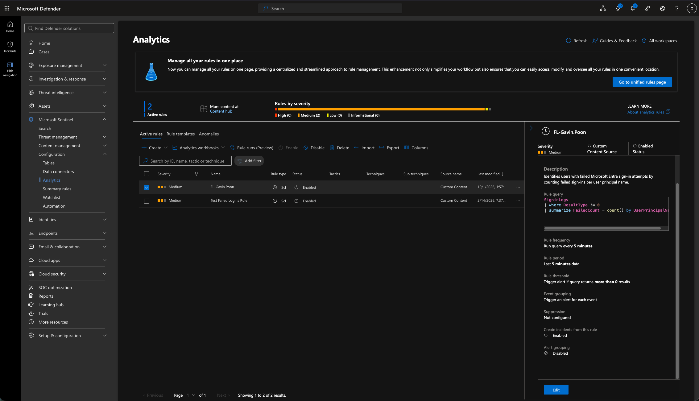

After the rule was saved, the Analytics page displayed two active rules.

The newly created `FL-Gavin.Poon` rule was shown as:

* Severity: Medium
* Rule type: Scheduled
* Status: Enabled
* Source: Custom Content
* Rule frequency: Every five minutes
* Rule period: Previous five minutes
* Incident creation: Enabled

This evidence confirmed that the custom failed-sign-in rule was successfully created and enabled.

### 6. Sentinel Playbook Template Catalog

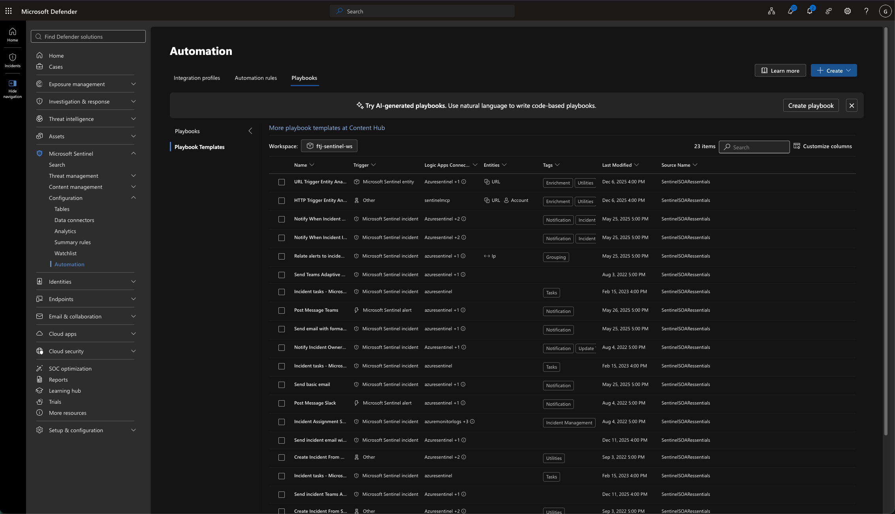

The Microsoft Sentinel Playbook Templates page displayed 23 templates for the selected workspace.

The catalog included templates for:

* Incident notifications
* Email notifications
* Microsoft Teams messages
* Incident-owner notifications
* Incident enrichment
* Incident management
* Utility actions

The catalog showed which automation options were available for review. It did not establish that any of the templates had been deployed.

### 7. Basic Incident Email Playbook Template

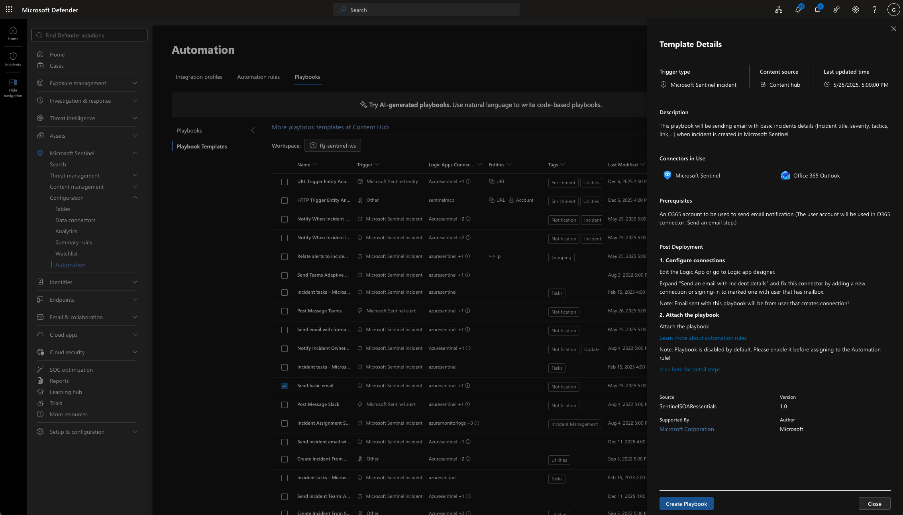

The **Send basic email** playbook template was reviewed.

The template used:

* A Microsoft Sentinel incident trigger
* A Microsoft Sentinel connector
* An Office 365 Outlook connector

The template required an Office 365 account with a mailbox. Its post-deployment instructions stated that the Outlook connection must be configured and that the playbook must be enabled before it can be attached to an automation rule.

This screenshot documents the template and its prerequisites. It does not show that the playbook was created, enabled, attached, or executed.

### 8. Teams Incident Owner Notification Template

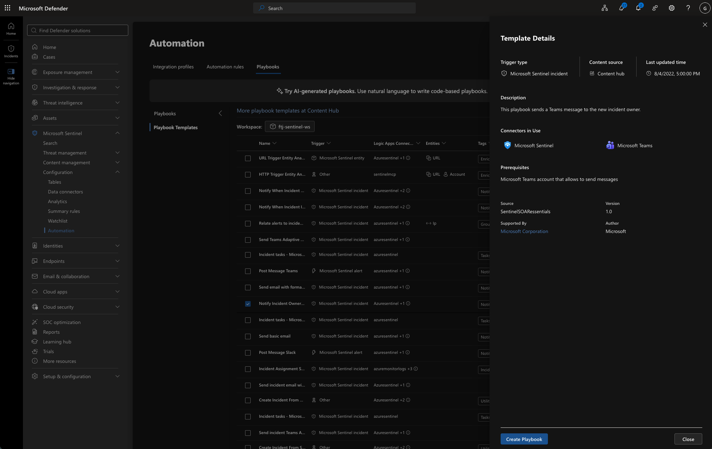

The incident-owner notification template was reviewed.

The template was designed to:

* Trigger from a Microsoft Sentinel incident.
* Send a Microsoft Teams message to the new incident owner.
* Use Microsoft Sentinel and Microsoft Teams connectors.

The listed prerequisite was a Microsoft Teams account authorized to send messages.

This screenshot confirms that the template was available. It does not demonstrate template deployment, connector authorization, or message delivery.

### 9. Formatted Incident Email Report Template

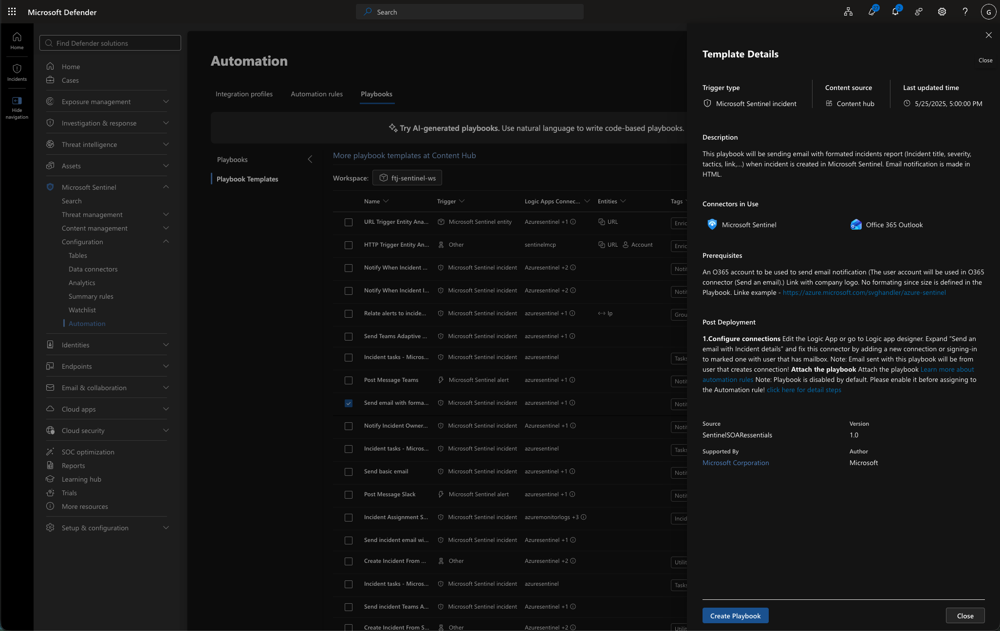

The formatted incident email template was reviewed.

The template was designed to:

* Trigger when a Microsoft Sentinel incident is created.
* Send an HTML-formatted incident report.
* Include information such as the incident title, severity, tactics, and incident link.
* Use Microsoft Sentinel and Office 365 Outlook connectors.

The template required an Office 365 account with a mailbox and post-deployment configuration of the Outlook connection. The instructions also stated that the playbook would be disabled by default and would need to be enabled before assignment to an automation rule.

This evidence documents template evaluation only. It does not show that the playbook was deployed or that an email was sent.

### 10. Automation Rules Status

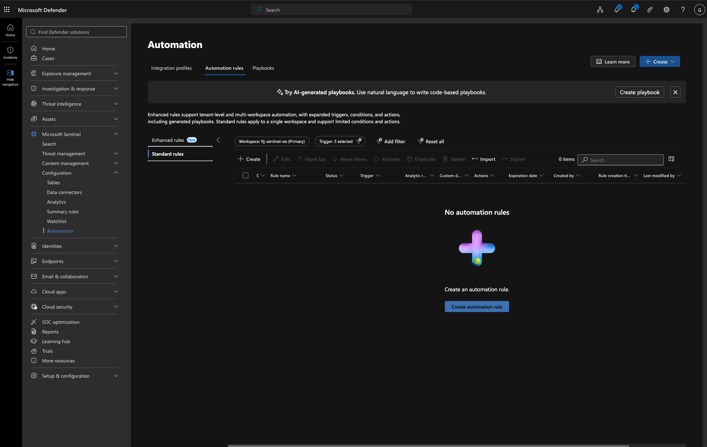

The Microsoft Sentinel Automation Rules page displayed zero configured standard automation rules.

This confirmed that no automation rule was available to invoke the reviewed playbook templates.

Without an automation rule and a deployed, enabled playbook, the workspace would not automatically perform the reviewed notification actions.

### 11. Incident Summary and PDF Export

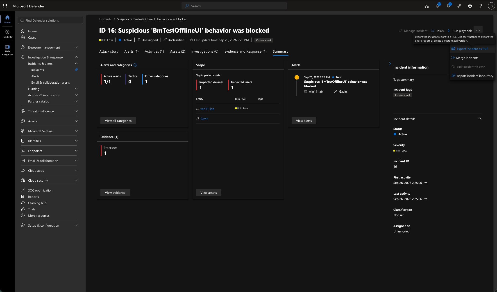

The Microsoft Defender incident summary displayed one incident involving suspicious PowerShell behavior.

The incident summary showed:

* Severity: Low
* Status: Active
* Assignment: Unassigned
* Classification: Not set
* Category: Suspicious activity
* Active alerts: 1 of 1
* Impacted devices: 1
* Impacted users: 1
* Process evidence: 1
* Impacted endpoint: `win11-lab`
* Associated user: `Gavin`

The incident action menu displayed the **Export incident as PDF** option.

This evidence demonstrates the reporting function used to preserve incident details in a portable document.

### 12. Exported Incident Report

[Exported incident report](12-exported-sentinel-incident-report.pdf)

The exported PDF contained the following report sections:

* Overview
* Attack story
* Scope
* Evidence and response
* Supporting data

The report documented:

* One low-severity active alert
* One impacted Windows 11 device
* One impacted user
* One malicious `powershell.exe` process
* A blocked remediation status
* A suspicious activity category
* No identified MITRE ATT&CK tactics

The PDF preserved the available incident details, attack-story relationships, impacted assets, process evidence, and supporting alert information.

The incident was still active, unassigned, and unclassified when the report was exported. The report therefore represents a point-in-time incident record rather than proof of final resolution.

## Key Findings

* A custom scheduled analytics rule was successfully created, validated, and enabled.
* The rule used `SigninLogs` to identify unsuccessful Microsoft Entra ID authentication attempts.
* Failed sign-ins were counted by user principal name.
* The rule ran every five minutes and searched the previous five minutes of data.
* The configured threshold could be met when the query returned a user with at least one failed sign-in.
* Incident creation was enabled, but alert grouping, entity mapping, suppression, and automation were not configured.
* Microsoft Sentinel provided several templates for email and Microsoft Teams incident notifications.
* The reviewed templates required connector authorization and post-deployment configuration.
* No automation rules were configured in the workspace.
* Microsoft Defender supported exporting the investigated incident as a structured PDF report.
* The exported report documented a malicious PowerShell process with a blocked remediation status.

## Limitations

* The evidence confirms analytics-rule configuration and enablement but does not show an alert or incident generated by the new rule.
* The query counted all failed sign-ins without distinguishing failure reasons, source addresses, locations, applications, or authentication methods.
* The alert threshold did not require a minimum `FailedCount` value greater than one.
* Entity mapping, MITRE ATT&CK mapping, custom details, alert details, suppression, and automation were not configured.
* The playbook evidence documents template review only.
* No playbook deployment, connector authorization, notification delivery, or automated response was demonstrated.
* No automation rules were configured.
* The exported PDF documents an existing Microsoft Defender incident and does not establish that the new failed-sign-in rule produced that incident.
* The exported incident remained active, unassigned, and unclassified.
* The findings represent the available lab data and configuration state when the evidence was collected.
