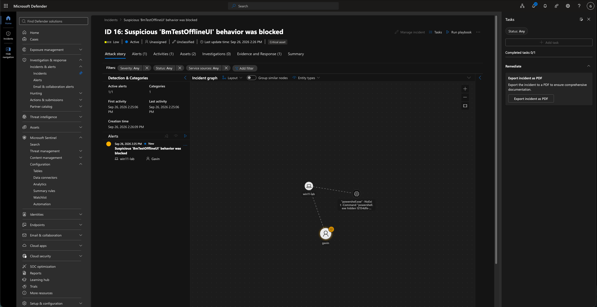
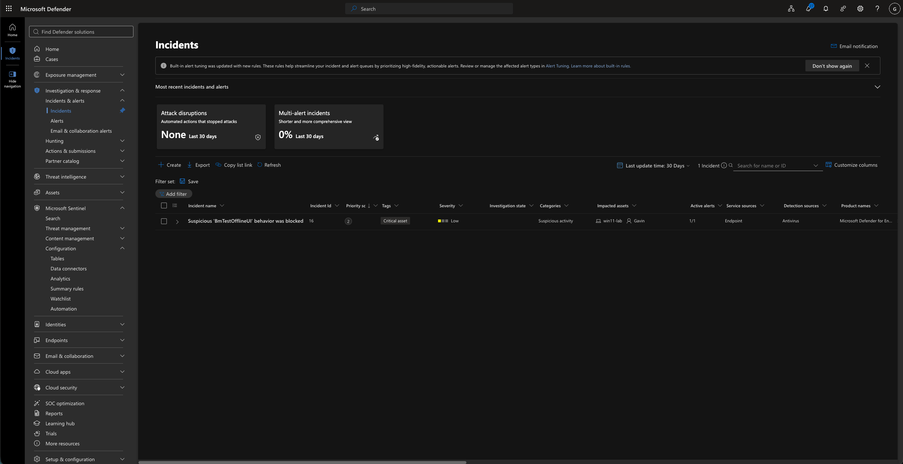
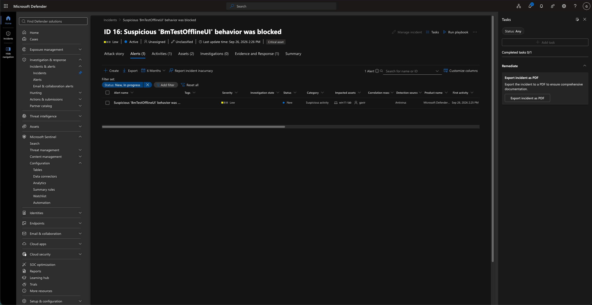
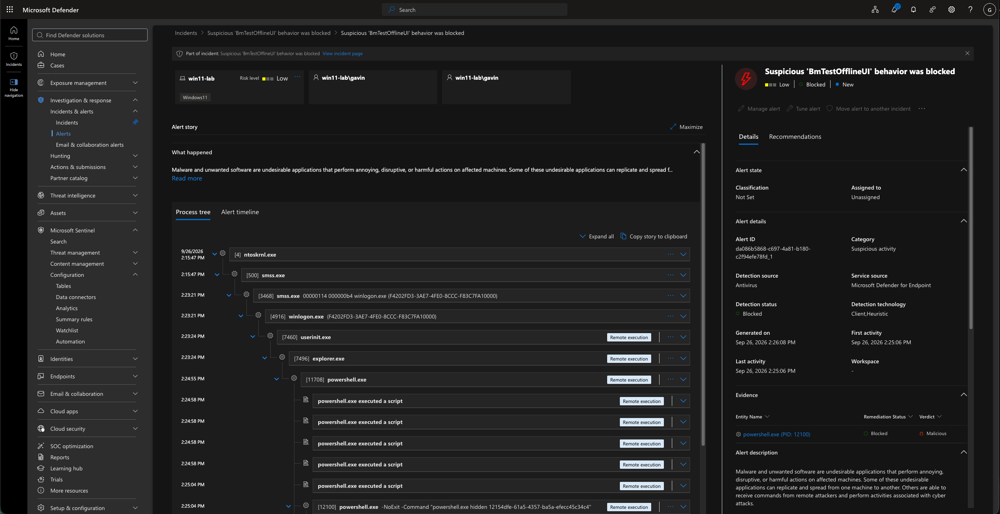
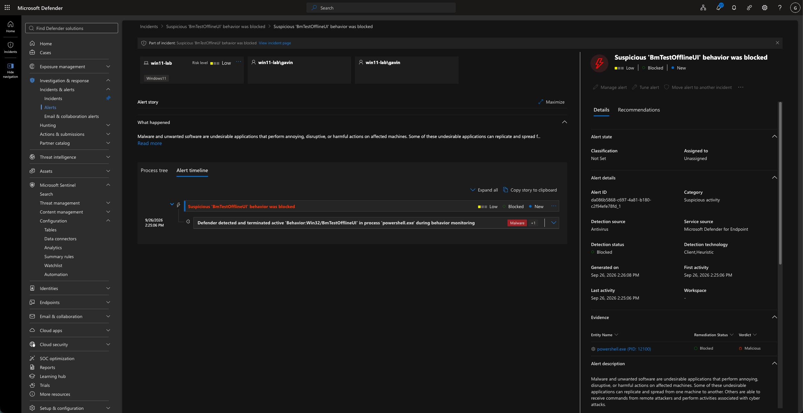
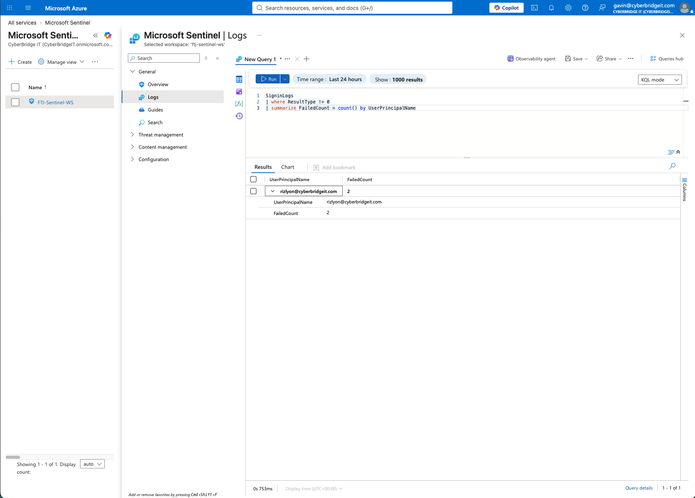
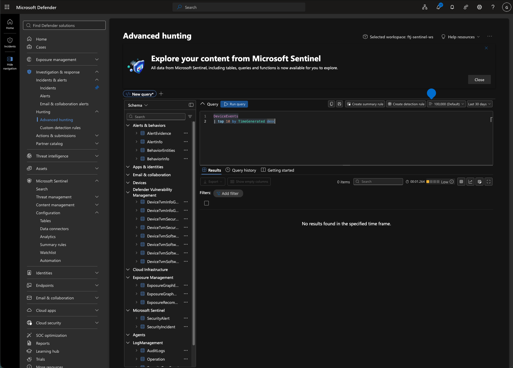
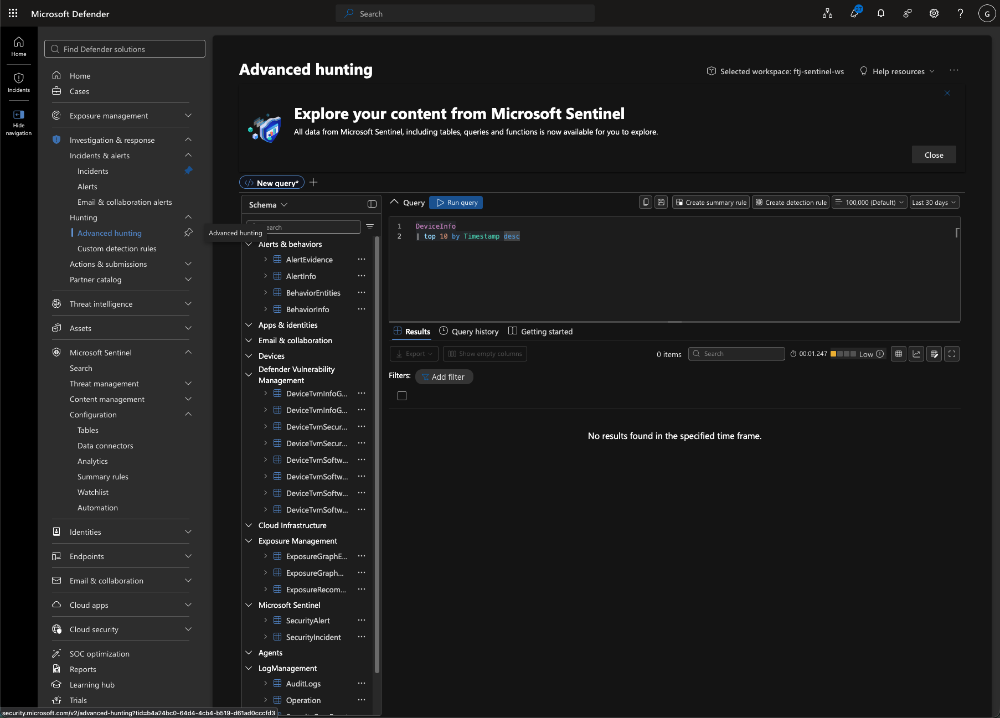

# Sentinel Incident Correlation and Endpoint Hunting Evidence

This folder documents an investigation involving a Microsoft Defender endpoint alert, the incident and entities associated with that alert, an identity-focused KQL query, and two endpoint advanced-hunting queries.

The evidence was reviewed through the unified Microsoft Defender and Microsoft Sentinel security experience.

## Evidence

### 1. Incident Attack Story and Entity Graph



The incident attack story showed the relationships between:

* The `win11-lab` endpoint
* The associated user
* A PowerShell process
* One suspicious-activity alert

The incident was displayed as low severity, active, unassigned, and unclassified. The graph provided a visual way to identify which endpoint, user, and process were connected to the alert.

This evidence demonstrates entity correlation. It does not independently establish the complete cause or scope of the activity.

### 2. Incident Queue



The incident queue contained one incident named `Suspicious 'BmTestOfflineUI' behavior was blocked`.

The incident record showed:

* Severity: Low
* Category: Suspicious activity
* Impacted endpoint: `win11-lab`
* One associated user
* Active alerts: 1 of 1
* Service source: Endpoint
* Detection source: Antivirus
* Product: Microsoft Defender for Endpoint

The queue provided the starting point for opening the incident and reviewing the associated alert and impacted entities.

### 3. Incident and Alert Correlation



The incident’s **Alerts** tab contained one associated alert. The alert was low severity, had a status of **New**, and was linked to the `win11-lab` endpoint and its associated user.

This confirmed that the endpoint alert had been grouped into the incident. Correlation allows an analyst to investigate related alerts and entities from one incident record instead of reviewing each item separately.

### 4. Alert Process Tree



The process tree displayed the sequence of processes leading to the detected PowerShell activity. The visible chain included Windows system and logon processes, `explorer.exe`, and `powershell.exe`, followed by several PowerShell script-execution entries.

The alert details showed:

* Category: Suspicious activity
* Detection source: Antivirus
* Service source: Microsoft Defender for Endpoint
* Detection status: Blocked
* Detection technology: Client heuristic
* Evidence entity: `powershell.exe`
* Evidence verdict: Malicious

The process tree supplied execution context that was not available from the incident title alone. It helped connect the detection to the process responsible for the observed behavior.

### 5. Detection and Termination Timeline



The alert timeline stated that Defender detected and terminated active `Behavior:Win32/BmTestOfflineUI` activity in `powershell.exe` during behavior monitoring.

The alert was shown as:

* Low severity
* Blocked
* New

The blocked status confirms that Defender responded to the detected behavior. It does not, by itself, prove that the endpoint required no further review. An analyst would still examine the process tree, related entities, other alerts, and surrounding activity before closing the incident.

### 6. Failed Sign-In Hunting Query



The following KQL query searched `SigninLogs` for unsuccessful authentication attempts and counted them by user:

```kusto
SigninLogs
| where ResultType != 0
| summarize FailedCount = count() by UserPrincipalName
```

The query returned one account with a `FailedCount` of `2` during the selected 24-hour period.

This result demonstrated how KQL can summarize authentication failures and identify accounts for additional review. Two failed sign-ins alone do not establish brute-force activity or account compromise. Additional context would be needed, including timestamps, source IP addresses, locations, applications, and authentication details.

### 7. DeviceEvents Advanced-Hunting Query



The following query searched for the ten most recent records in the `DeviceEvents` table:

```kusto
DeviceEvents
| top 10 by TimeGenerated desc
```

The query returned zero records within the selected 30-day period.

The zero-result outcome means that the query did not retrieve records from `DeviceEvents` under the selected workspace and time range. It does not prove that no endpoint activity occurred or that the device was secure.

### 8. DeviceInfo Advanced-Hunting Query



The following query searched for the ten most recent records in the `DeviceInfo` table:

```kusto
DeviceInfo
| top 10 by Timestamp desc
```

The query returned zero records within the selected 30-day period.

The result showed that endpoint inventory records were not returned from the queried table under the selected conditions. The screenshot does not establish whether this was caused by workspace scope, table population, telemetry configuration, retention, or another data-availability issue.

## Key Findings

* Defender grouped one endpoint alert with the affected device, user, and PowerShell process.
* The process tree provided execution context for the suspicious PowerShell behavior.
* Defender reported that it detected and terminated the behavior.
* The identity query identified one account with two failed sign-ins in the selected period.
* The `DeviceEvents` and `DeviceInfo` queries returned no records.
* Identity telemetry was available for KQL analysis, while the two endpoint tables did not return data under the selected conditions.

## Limitations

* The investigation involved one authorized lab endpoint.
* The incident contained only one associated alert.
* The evidence did not establish whether the detected behavior caused additional activity outside the displayed process chain.
* Two failed sign-ins were insufficient to classify the activity as an attack.
* The cause of the empty endpoint-query results was not determined.
* A zero-result query must not be interpreted as proof that an endpoint is secure.
* The findings represent the available data and selected time ranges when the evidence was collected.
